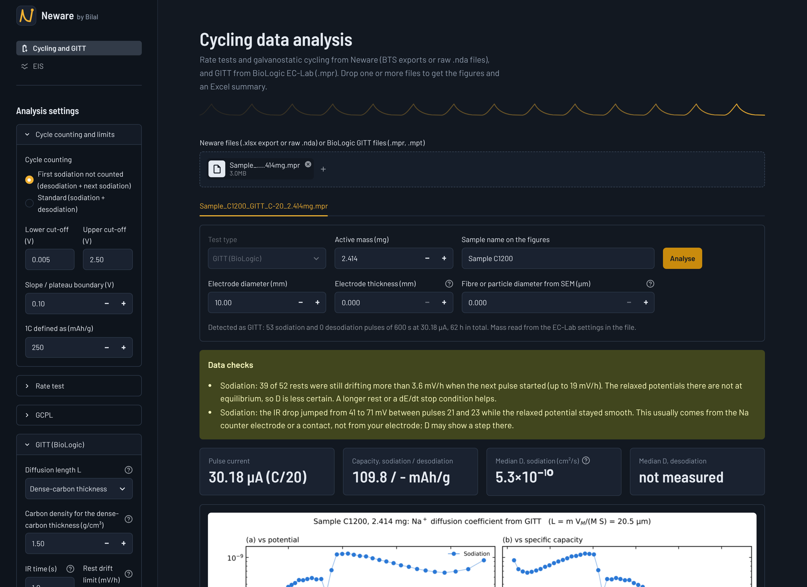
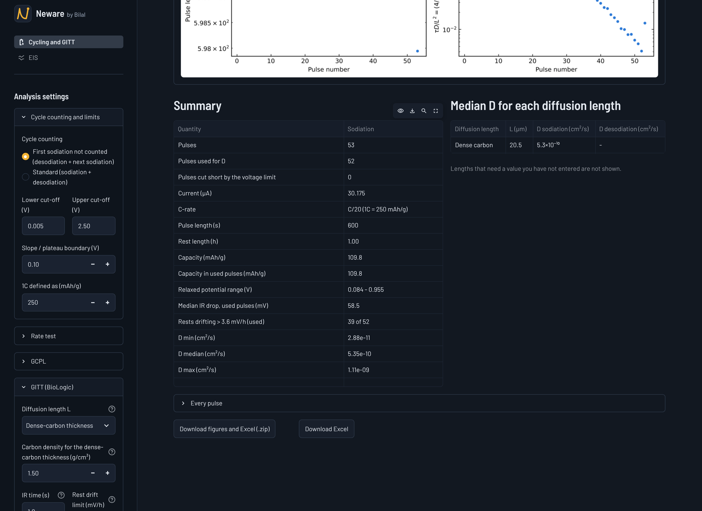
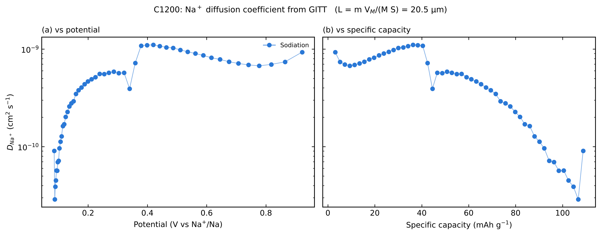
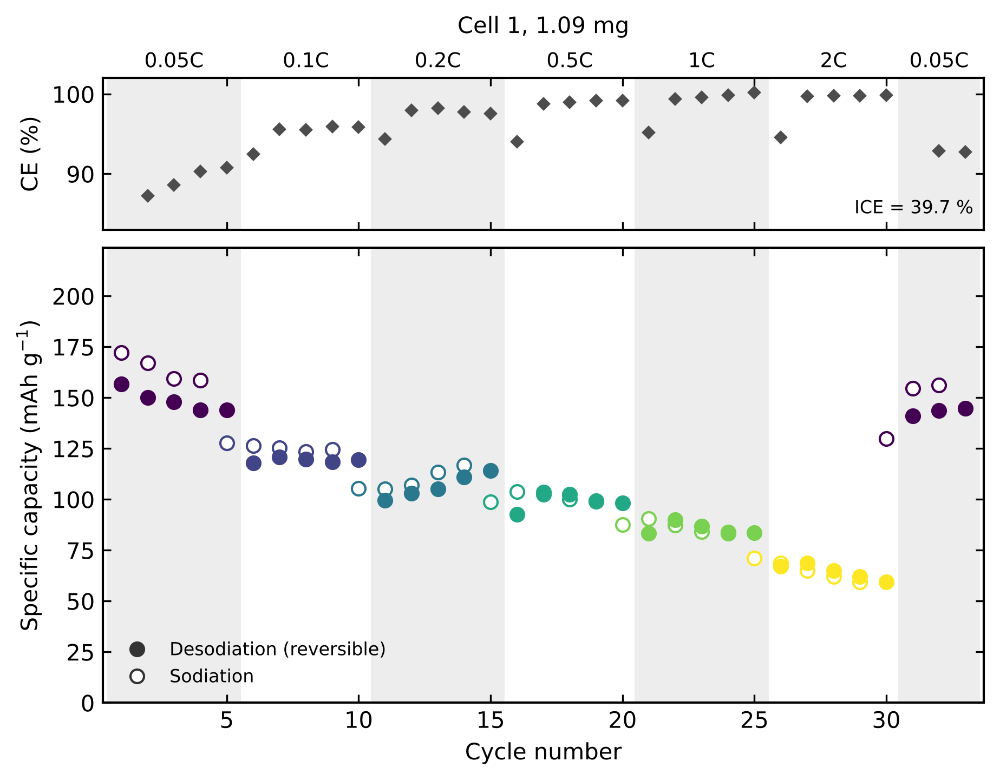
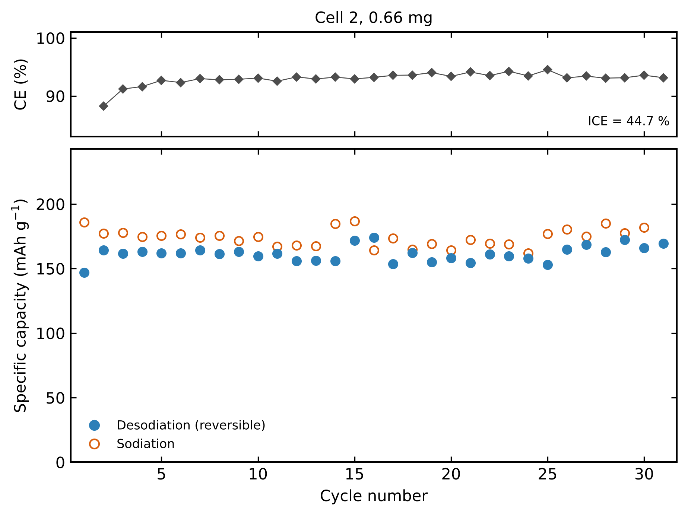
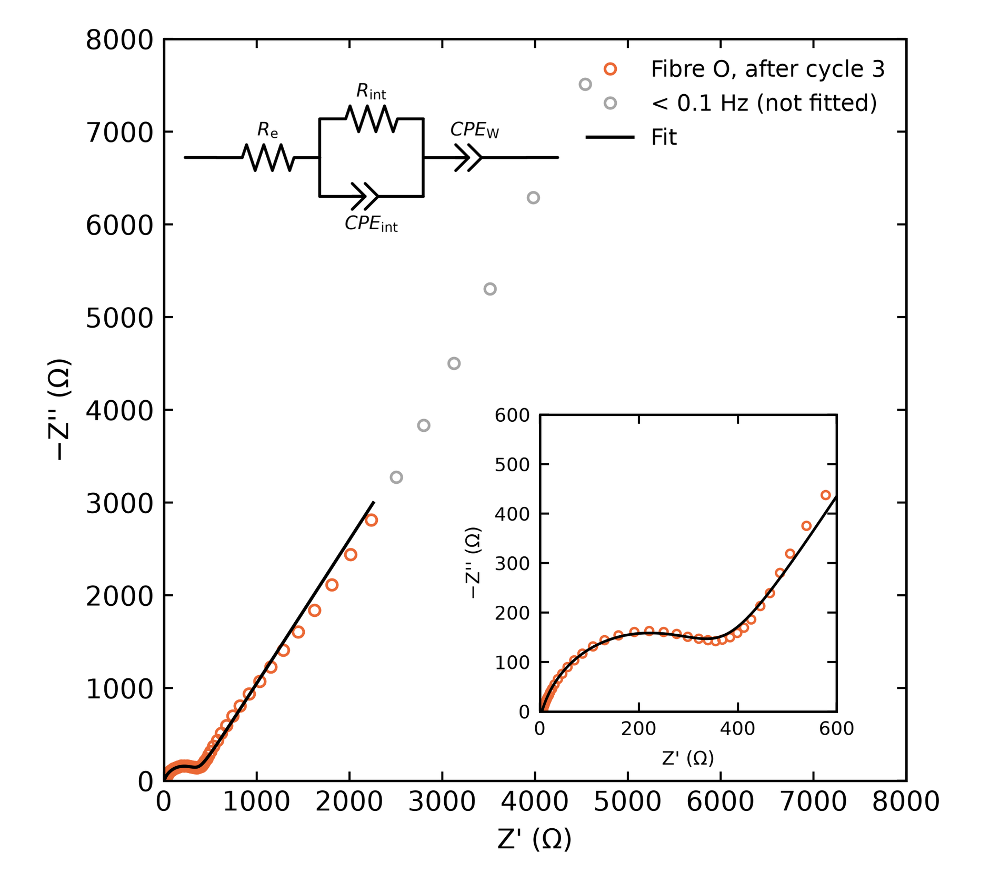

# Data analysis for electrochemical battery testing

A desktop app that turns raw battery-cycler files into publication-ready figures and an Excel
table of every number behind them. It reads **Neware / BTS** exports and **BioLogic EC-Lab**
files and covers the three measurements used to characterise a sodium-ion half-cell:
**rate capability**, **galvanostatic cycling (GCPL)**, **GITT**, and **impedance (EIS)**.

I wrote it for my master's thesis at TU Darmstadt (hard-carbon anodes for sodium-ion
batteries, made from coal waste), where every cell had to be processed the same way.
Doing it by hand in Origin took about an hour per cell and the cycle-counting convention
drifted between samples. This does it in under a minute and applies one convention to all of them.

The app runs locally in a browser. Nothing is uploaded anywhere.



---

## Try it on the included example

`example_data/` holds one real measurement from my thesis: a 95-hour GITT run on a
hard-carbon electrode (sample C1200, 2.414 mg active mass, C/20, 10-minute pulses,
1-hour rests) recorded on a BioLogic VMP3.

```bash
pip install -r requirements.txt
python -m streamlit run app.py
```

Then, in the browser:

1. Drag `example_data/Sample_C1200_GITT_C-20_2.414mg.mpr` onto the upload box.
   The file is recognised as GITT and the active mass is read out of the EC-Lab settings block.
2. In the sidebar, open **GITT (BioLogic)** and set **Diffusion length L** to *Dense-carbon thickness*.
3. Press **Analyse**.

You should get this:

| | |
|---|---|
| Pulses found | 53 sodiation, 0 desodiation |
| Pulses used for *D* | 52 |
| Pulse current | 30.18 µA (C/20) |
| Sodiation capacity | 109.8 mAh g⁻¹ |
| Diffusion length *L* | 20.5 µm |
| *D*(Na⁺) median | 5.3 × 10⁻¹⁰ cm² s⁻¹ |
| *D*(Na⁺) range | 2.9 × 10⁻¹¹ – 1.1 × 10⁻⁹ cm² s⁻¹ |



The figures and the Excel file this produces are committed in
[`example_output/`](example_output) so you can see the result without running anything:



It also prints two things that are wrong with that measurement, which is the part I
care about most — see [Checking the data](#checking-the-data) below.

---

## What it does

### Rate capability (Neware `.xlsx` or raw `.nda`)
Splits the raw detail data into half-cycles, detects the C-rate of each one from the
current, and reports capacity, coulombic efficiency, mean potentials, voltage hysteresis
and the slope/plateau capacity split per cycle, then summarises each rate block
(mean ± SD, retention, recovery after returning to the low rate).



The C-rate blocks are detected from the current, not read from a step file, and the
shaded bands and labels across the top come out of that. This cell gives back 96 % of its
starting capacity when the rate returns to 0.05C after 2C, which is the number this
measurement exists to produce. It also makes three further figures: voltage profiles at
each rate, the first cycles in detail, and a summary of the rate blocks.

### Galvanostatic cycling, GCPL (Neware `.xlsx` or raw `.nda`)
Capacity and coulombic efficiency against cycle number, CE stabilisation against chosen
thresholds, irreversible capacity per cycle, voltage profiles of selected cycles, and
d*Q*/d*V* curves compared on one graph.



The ICE printed on the figure is the first desodiation divided by the first sodiation,
taken from the raw half-cycles rather than from the cycler's own cycle table, which counts
cycles differently and quietly changes what "cycle 1" means.

Both of these let you pick the cycle-counting convention, which matters in a half-cell:
the first sodiation is a formation step, so "cycle 1" can mean the first
sodiation + desodiation pair, or the first *desodiation* + the sodiation after it.
Coulombic efficiency is always desodiation ÷ the sodiation immediately before it, so the
first desodiation gives the ICE either way.

### GITT (BioLogic `.mpr` or `.mpt`)
Finds every current pulse and the rest after it, then applies the Weppner–Huggins equation

$$D = \frac{4}{\pi\tau}\,L^{2}\left(\frac{\Delta E_s}{\Delta E_\tau}\right)^{2}
\qquad\text{valid for }\tau \ll \frac{L^{2}}{D}$$

where Δ*E*<sub>s</sub> is the change in relaxed potential across the pulse and Δ*E*<sub>τ</sub>
the change during it, measured after the IR drop. The relaxed potential is the median of the
last 30 s of each rest rather than the final point, so noise in one sample does not move it.

The diffusion length *L* is the one honest difficulty in GITT, and the app does not hide it.
You choose between four definitions and it reports the median *D* for each one you have the
numbers for:

| Setting | *L* | Use it when |
|---|---|---|
| Electrode thickness | measured thickness | upper bound; gives unphysically large *D* for a porous electrode |
| Dense-carbon thickness | *L* = *m*·*V*<sub>M</sub>/(*M*·*S*) = *m*/(ρ·*S*) | default; the form used by Ledwoch et al. 2022 |
| Fibre radius (SEM) | *r*/2 | electrospun fibres, with the mean diameter from SEM |
| Particle radius (SEM) | *r*/3 | spherical powder, with the mean diameter from SEM |

*D* scales with *L*², so the choice shifts the whole curve up or down without changing its
shape. The app says so on the figure, and the point of reporting all four is that a reader
can convert between them.

Points where Δ*E*<sub>s</sub> is not much smaller than Δ*E*<sub>τ</sub> — that is, where
τ*D*/*L*² = (4/π)(Δ*E*<sub>s</sub>/Δ*E*<sub>τ</sub>)² exceeds 0.3 and the thin-film assumption
fails — are drawn as open symbols and labelled *apparent D*, not quietly plotted as if they
were fine.

### Impedance, EIS (BioLogic `.mpr` or `.mpt`)
On its own page. Runs a Lin-KK Kramers–Kronig check (Schoenleber et al. 2014) that also
suggests how far down in frequency each spectrum can be trusted, then fits an equivalent
circuit — either R<sub>e</sub>–(R<sub>f</sub>‖CPE₁)–(CPE₂‖(R<sub>ct</sub>–Z<sub>w</sub>)) from
Jin et al. 2014, or a one-arc Randles circuit — with parameter uncertainties, and produces
Nyquist and Bode figures plus the fit table as CSV and LaTeX.



The fitted circuit is drawn on the figure, and the points the Lin-KK check rejects — here
everything below 0.1 Hz, where the low-frequency tail stops being Kramers-Kronig
consistent — are greyed out and left out of the fit instead of being fitted anyway.

> The rate-capability, cycling and impedance figures above are real measurements from my
> thesis, shown without their raw files because that data is not published yet. The GITT
> figure and everything in `example_output/` come from the measurement included in
> `example_data/`, so that one you can reproduce yourself.

---

## Checking the data

Every analysis ends with a plain-language list of what is wrong with the measurement.
This is the part that saved me the most time: it catches in seconds the things that
otherwise show up weeks later as a strange-looking curve. For GITT it checks:

- **rests that were still drifting** when the next pulse started (default limit 3.6 mV h⁻¹,
  i.e. d*E*/d*t* ≤ 0.001 mV s⁻¹ as in Ledwoch et al. 2022) — the relaxed potential is then
  not an equilibrium potential and *D* is less certain;
- **sudden steps in the IR drop** between neighbouring pulses while the relaxed potential
  stays smooth, which points at the sodium counter electrode or a contact rather than at the
  working electrode;
- **sudden potential steps inside a pulse or its rest** — those pulses are excluded;
- **pulses cut short by the voltage limit**, and a loop that kept running for hours after the
  limit was first reached (an EC-Lab setting mistake: `EL = pass` with `nc` set to the number
  of pulses actually needed);
- **a low-voltage plateau that was never reached**, when the relaxed potential never goes near
  the cut-off because the cell hits the limit under current first;
- **points where the Weppner–Huggins assumption is weak**, as described above.

On the included example it finds two real faults: 39 of 52 rests had not relaxed, and the IR
drop jumps from 41 to 71 mV between pulses 21 and 23. Both are visible in the screenshot above.

---

## Running it

Python 3.10 or newer.

```bash
git clone https://github.com/bilaldawoodmughal/electrochemical-battery-data-analysis.git
cd electrochemical-battery-data-analysis
pip install -r requirements.txt
python -m streamlit run app.py
```

The app opens at <http://localhost:8501>. On Windows, `Start Neware by Bilal.bat` does the
same thing with a double-click.

Every analysis module also runs on its own, without the app:

```bash
python analyse_gitt.py                        # no argument: runs the included example
python analyse_gitt.py example_data/Sample_C1200_GITT_C-20_2.414mg.mpr
python analyse_gcpl.py  my_cell.xlsx --mass 0.66
python analyse_rate_test.py my_cell.xlsx
python nda_to_excel.py  my_cell.nda          # raw Neware .nda -> .xlsx, no BTSDA needed
python compare_samples.py                     # several cells on one set of axes
```

Each writes 300 dpi PNGs and an Excel file with every number behind the figures, laid out
for re-plotting in Origin.

---

## Repository layout

```
app.py                 page menu (Streamlit multipage)
page_cycling.py        "Cycling and GITT" page
page_eis.py            "EIS" page
ui.py                  shared style, header, footer

analyse_rate_test.py   rate capability
analyse_gcpl.py        galvanostatic cycling
analyse_gitt.py        GITT and Weppner-Huggins
EIS_Analyser.py        Lin-KK check and equivalent-circuit fitting
nda_to_excel.py        raw Neware .nda reader
compare_samples.py     several cells on one figure
galvani_biologic.py    BioLogic .mpr reader (from the galvani project, GPL-3.0-or-later)

example_data/          one real GITT measurement
example_output/        the figures and Excel file it produces
docs/                  screenshots
```

---

## Notes and limits

- The Neware readers were written against BTS exports with `Info`, `Cycle_*`, `Statis_*` and
  `Detail_*` sheets, and against `.nda` files from the same software version. Other versions
  may need a change in the reader.
- Everything assumes a **half-cell against sodium metal**: discharge = sodiation of the
  carbon, charge = desodiation. The defaults (1C = 250 mAh g⁻¹, 0.005–2.5 V, 10 mm electrode)
  are the ones I used and can all be changed in the sidebar.
- GITT gives a **chemical** diffusion coefficient under the assumptions of the Weppner–Huggins
  model. Compare values between samples measured and analysed the same way; comparing them
  against literature values obtained with a different *L* means little.

## Built with

Python, [Streamlit](https://streamlit.io), NumPy, pandas, Matplotlib, SciPy, openpyxl.
BioLogic files are read with a bundled copy of the reader from the
[galvani](https://github.com/echemdata/galvani) project (GPL-3.0-or-later).
Interface font: [Barlow](https://fonts.google.com/specimen/Barlow) (SIL Open Font License).

## References

- W. Weppner, R. A. Huggins, *J. Electrochem. Soc.* **124** (1977) 1569.
- L. Ledwoch et al., *J. Power Sources* (2022) — GITT protocol and the *L* = *m*/(ρ·*S*)
  diffusion length for hard carbon.
- M. Schoenleber, D. Klotz, E. Ivers-Tiffée, *Electrochim. Acta* **131** (2014) 20 — Lin-KK.
- Y. Jin et al., *Electrochim. Acta* **141** (2014) 302 — the EIS equivalent circuit.

## Licence

GPL-3.0-or-later — see [LICENSE](LICENSE). The bundled BioLogic reader is GPL-3.0-or-later,
so the whole project is released under the same licence.

The example measurement in `example_data/` is my own thesis data and is shared here so the
code can be tried out.

## Author

**Bilal Dawood** — Erasmus Mundus FAME-AIS master's student, TU Darmstadt.
Master's thesis: *Optimising Coal Waste-Derived Electrospun Carbon Fibre Anodes for
Sodium-Ion Batteries*.
